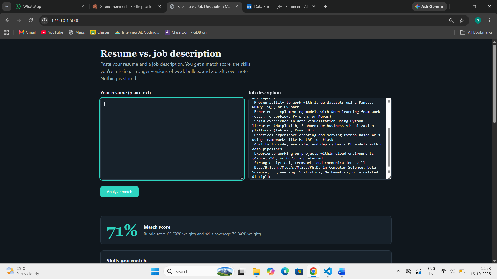
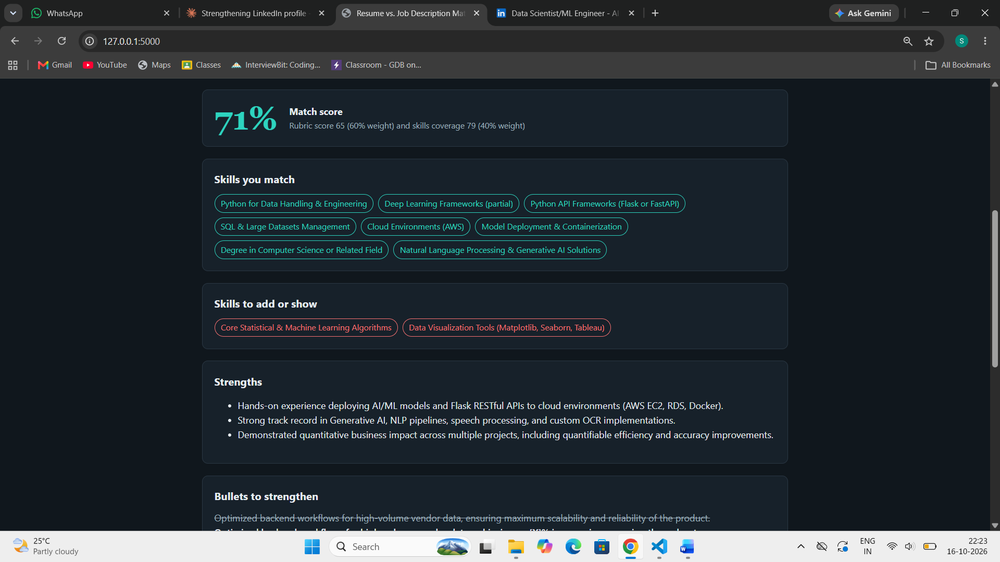

Resume vs. Job Description Matcher

Paste a resume and a job description. Get a match score, the skills you are missing, stronger versions of vague bullets, and a draft cover note, plus warnings when the AI writes something your resume does not support.

Built as a personal project to explore reliable LLM output: structured JSON, verified evidence, and a grounding check against hallucinated claims

Features

Match score (0-100) that blends an LLM rubric with a verified skills coverage score
Matched and missing skills, with an exact resume quote as proof for every match
Bullet rewrites that use only tools and facts already in your resume, with [X] slots for results you must fill in yourself
Tailored cover note that is honest about skills you have not used yet
Grounding audit that flags unsupported tools, numbers, and overclaims before you copy anything
Works with free LLM providers (Gemini, Groq, local Ollama) or Claude, switched with two lines in .env

How it works

Resume + JD -> LLM (JSON schema) -> Pydantic validation -> evidence check -> grounding audit
                                                              |                    |
                                                  skills coverage score     warnings (+ one auto-retry)

                                                  The model returns a structured JSON object: a rubric score, the JD's requirements with a status and a resume quote for each, bullet rewrites, and a cover note.

Pydantic validates the JSON and normalises small format differences between models. Invalid output triggers one retry.
Evidence check: code confirms every quoted proof really appears in your resume. A skill with no verifiable proof is downgraded.
Grounding audit: deterministic code flags tool names, numbers, and phrases like "led" or "enterprise-scale" in the rewrites or cover note that your resume does not contain. If anything is flagged, the model gets one chance to fix it.

Scoring

final score = 0.6 x LLM rubric score + 0.4 x verified skills coverage

LLM rubric (0-100): required skills 40, relevant experience 30, evidence of impact 20, seniority fit 10
Skills coverage: required skills count double; matched = 1, partial = 0.5, missing = 0; every match must pass the evidence check